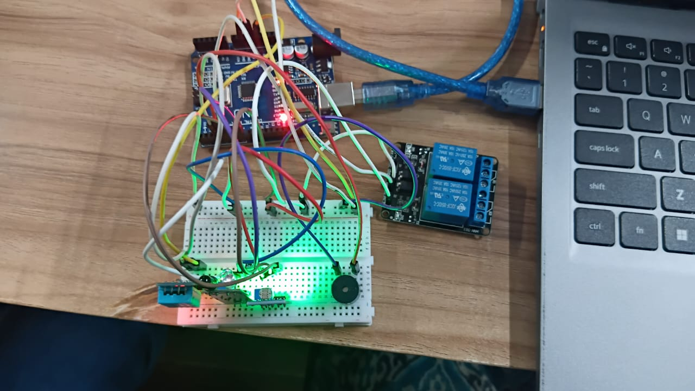

# 🧼 Arduino-Based Smart Hand Washing System

### An Intelligent Multi-Sensor-Based Embedded Systems Project

A smart hand washing automation system developed using Arduino Uno, IR sensor, LDR sensor, DHT11 temperature sensor, relay module, and DC water pump. This project demonstrates touchless water control, environmental monitoring, and automated alert mechanisms through sensor integration and embedded systems programming.

## 📌 Project Overview

The **Arduino-Based Smart Hand Washing System** is an embedded systems project designed to automate water control and monitor environmental conditions using multiple sensors.

The system uses an IR sensor to detect hand presence and automatically controls a DC water pump through a relay module. An LDR sensor monitors surrounding light conditions, while a DHT11 sensor measures temperature and humidity. A buzzer provides an alert when the temperature reaches or exceeds 33°C.

The water pump operates automatically for 3 seconds when a hand is detected, providing a touchless water dispensing mechanism.

This project demonstrates the integration of multiple sensors and actuators using an Arduino microcontroller for automation and environmental monitoring.

## 🎯 Objectives

- Develop a touchless hand washing automation system.
- Implement automatic water control using an IR sensor.
- Control a DC water pump through a relay module.
- Monitor surrounding light conditions using an LDR sensor.
- Measure temperature and humidity using a DHT11 sensor.
- Implement temperature-based buzzer alerts.
- Display real-time sensor readings through the Serial Monitor.
- Gain practical experience in multi-sensor interfacing and embedded systems development.

## 🛠️ Components Required

| S. No. | Component | Purpose |
|---|---|---|
| 1 | Arduino Uno | Controls the complete system |
| 2 | IR Sensor | Detects hand presence |
| 3 | LDR Sensor Module | Monitors surrounding light conditions |
| 4 | DHT11 Sensor | Measures temperature and humidity |
| 5 | 1-Channel Relay Module | Controls the water pump |
| 6 | DC Water Pump | Dispenses water automatically |
| 7 | Buzzer | Provides temperature alerts |
| 8 | Breadboard | Supports circuit connections |
| 9 | Jumper Wires | Establish electrical connections |
| 10 | USB Cable | Programs and powers the Arduino |
| 11 | External Power Supply | Supplies power to the water pump |

## ⚙️ Working Principle

The system operates by integrating multiple sensors with an Arduino Uno microcontroller.

1. **Hand Detection:** The IR sensor detects the presence of a hand near the washing system.
2. **Water Pump Activation:** When a hand is detected, the Arduino activates the relay module to turn ON the DC water pump.
3. **Automatic Water Control:** The water pump operates for 3 seconds and then automatically turns OFF.
4. **Light Monitoring:** The LDR sensor monitors the surrounding light intensity.
5. **Temperature Monitoring:** The DHT11 sensor continuously measures the surrounding temperature and humidity.
6. **Temperature Alert:** When the temperature reaches or exceeds 33°C, the buzzer is activated.
7. **Serial Monitoring:** Sensor readings, hand detection status, light conditions, and temperature information are displayed through the Arduino Serial Monitor.

 ## 💻 Arduino Code

[View Arduino Code](./Handwashing_Automation_Monitoring.ino)

## 📸 Project Output

### Circuit Connection

*Figure 1: Hardware implementation of the Arduino-based smart hand washing system.*

### Serial Monitor Output

*Figure 2: Real-time sensor readings and system status displayed through the Arduino Serial Monitor.*

## 💻 Software and Tools

- **Arduino IDE** — For writing, compiling, and uploading the program.
- **Arduino C/C++** — For programming sensor interfacing and automation.
- **DHT Library** — For reading temperature and humidity from the DHT11 sensor.
- **USB Connection** — For uploading the program to the Arduino Uno.
- **Serial Monitor** — For displaying real-time sensor readings and system status.

## 🚀 How to Run the Project

1. Clone or download this repository.
2. Open the main Arduino `.ino` file in the Arduino IDE.
3. Install the required DHT sensor library.
4. Connect the Arduino Uno to your computer using a USB data cable.
5. Select **Tools → Board → Arduino Uno**.
6. Select the correct port under **Tools → Port**.
7. Verify the code and click **Upload**.
8. Open the Serial Monitor and set the baud rate to match the program (9600 baud if configured as `Serial.begin(9600)`).
9. Place your hand near the IR sensor and observe the automatic water pump operation.
10. Monitor the temperature, humidity, light readings, and buzzer alert.

## 📚 Concepts Learned

- Understanding Arduino Uno microcontroller programming.
- Interfacing multiple sensors with a microcontroller.
- Working with digital input and output pins.
- Understanding IR sensor-based hand detection.
- Monitoring light intensity using an LDR sensor.
- Measuring temperature and humidity using a DHT11 sensor.
- Controlling a DC water pump using a relay module.
- Implementing temperature-based alert mechanisms.
- Using conditional statements and timing functions.
- Displaying real-time sensor data through the Serial Monitor.
- Integrating multiple hardware components into an embedded system.

## 🔮 Future Improvements

- Integrate an LCD or OLED display to show real-time sensor readings.
- Add an ultrasonic sensor for improved hand detection.
- Implement IoT-based monitoring using ESP32 or Wi-Fi connectivity.
- Develop a mobile application to monitor system status.
- Optimize water consumption using intelligent pump control.
- Add water-level monitoring to detect low water conditions.
- Implement automatic temperature and environmental data logging.

## 🏢 Applications

- Smart hand washing stations.
- Touchless water dispensing systems.
- Public hygiene facilities.
- Smart buildings.
- Automated water management systems.
- Educational embedded systems projects.
- Sensor-based automation applications.

---

**Tags:** `Arduino` `ArduinoUno` `SmartHandWashing` `EmbeddedSystems` `IRSensor` `LDR` `DHT11` `Automation` `IoT` `Electronics`
